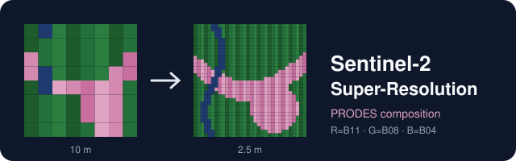
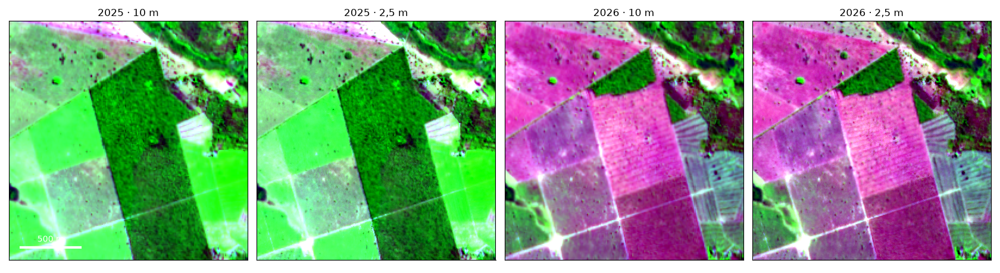
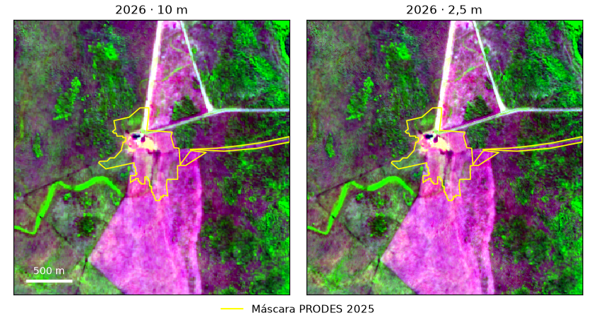
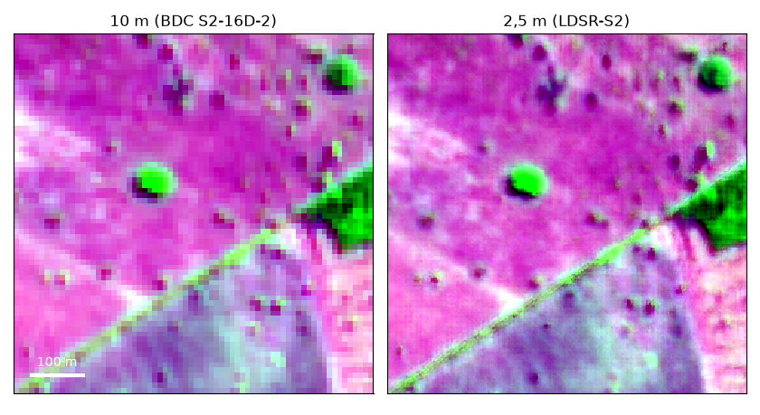

# Sentinel-2 Super-Resolution for PRODES Composition

<p align="center">
  
</p>

<p align="center">
  
  
  
</p>

Super-resolução dos mosaicos Sentinel-2 de 16 dias do Brazil Data Cube (`S2-16D-2`), de 10 m para 2,5 m, com o modelo de difusão **LDSR-S2** (ESA OpenSR). O objetivo é apoiar a interpretação visual do PRODES na composição R = B11, G = B08, B = B04. O mesmo script e os mesmos parâmetros foram usados nos tiles do Pantanal e do Lavrado, com os mosaicos de 2026-07-28 e 2025-07-28.

## Exemplos

Composição PRODES (R = B11, G = B08, B = B04). Em cada figura, as imagens de 10 m e de 2,5 m usam o mesmo realce (percentis de 2 a 98% da imagem de 10 m).

<p align="center">
  
</p>

Tile 018023, mosaicos de 28/07/2025 e 28/07/2026. Um fragmento de floresta (verde escuro) presente em 2025 aparece desmatado em 2026 (rosa), fora da máscara PRODES. A 2,5 m, os limites do corte, as faixas de preparo do solo e a borda remanescente ao norte ficam mais nítidos.

<p align="center">
  
</p>

Tile 018026, mosaico de 28/07/2026, com a máscara PRODES 2025 (desmatamento acumulado) em amarelo. A área aberta ao sul da máscara é desmatamento posterior a ela. É esse tipo de polígono que o intérprete delimita.

<p align="center">
  
</p>

Detalhe de 700 m na borda do mesmo corte do tile 018023. A 10 m, árvores isoladas, a estrada e o limite entre talhões aparecem como blocos de pixels. A 2,5 m, essas feições ganham forma.

## Uso no PRODES

O PRODES mapeia o desmatamento por interpretação visual, comparando a imagem do ano com a do ano anterior e delimitando apenas o que está fora da máscara de desmatamento acumulado. A 10 m, cortes pequenos, bordas irregulares, estradas e árvores remanescentes ficam no limite do que se distingue. A 2,5 m, os limites ficam mais definidos, o que facilita a delimitação dos polígonos e a separação entre corte raso e degradação.

Alguns cuidados no uso:

- A super-resolução não cria informação que não exista no dado de 10 m. Ela reconstrói o detalhe que o modelo considera mais provável para aquela textura. Use o produto de 2,5 m para delimitar e consulte a imagem de 10 m em caso de dúvida.
- A B11 (canal vermelho da composição) é uma banda de 20 m. O detalhe dela a 2,5 m vem das bandas de 10 m (ver 3.4). A cor representa bem a resposta do SWIR, mas o contorno vem do visível e do infravermelho próximo.
- Os mosaicos de 16 dias do BDC podem ter nuvens e sombras residuais, como o mosaico de 2025 do tile 018026, que fica nublado sobre a área do segundo exemplo. Elas passam para o produto de 2,5 m sem alteração.

## 1. Instalação

Requer Python 3.10 ou superior e uma GPU NVIDIA com CUDA. Instale o [PyTorch](https://pytorch.org/get-started/locally/) para a sua versão de CUDA e depois:

```bash
pip install -r requirements.txt
```

Os pesos do modelo são baixados automaticamente na primeira execução. Dependências que faltarem também são instaladas pelo próprio script, no bloco 2.

## 2. Uso

O [`s2_super_resolution.py`](s2_super_resolution.py) é dividido em blocos `# %%`, que podem ser executados como células no Jupyter ou no VS Code, ou de uma vez com `python s2_super_resolution.py`. Os parâmetros ficam no bloco 1.

| Parâmetro | Descrição |
| --- | --- |
| `TILES` | Tiles da grade BDC_SM_V2 (`hhhvvv`) |
| `DATES` | Data de início do mosaico de 16 dias. Os mosaicos do `S2-16D-2` começam a cada 16 dias a partir de 1º de janeiro: `2026-07-28` corresponde ao período de 28/07 a 12/08/2026 |
| `ROOT`, `OUT_DIR`, `DOWNLOAD_DIR` | Pasta de trabalho (modelos), resultados e mosaicos baixados |
| `ROI_LAT`, `ROI_LON`, `ROI_SIZE_KM` | `None` processa o tile inteiro; com um ponto, apenas um quadrado de `ROI_SIZE_KM` em torno dele |
| `MODE` | `fast` (padrão), `combined` ou `separate` (ver 3.5) |
| `STEPS` | Passos DDIM da difusão. 25 tem a mesma qualidade de 50 e é 1,6 vez mais rápido |
| `OVERWRITE` | `False` pula os pares tile e data que já têm resultado |

O bloco 2 processa todos os pares `TILES` × `DATES`, uma data por vez. Se a execução for interrompida, basta rodar o bloco 2 novamente: os pares prontos são pulados e o tile em andamento continua da última faixa gravada. Os blocos 3 e 4, opcionais, mostram a composição PRODES do último resultado e comparam os modos; as mesmas rotinas estão em [`tools/`](tools).

## 3. Metodologia

### 3.1 Dados de entrada

Para cada tile e data, o script baixa do STAC do BDC (`https://data.inpe.br/bdc/stac/v1`) os COGs do mosaico `S2-16D-2`:

- as bandas B02, B03, B04 e B08, de 10 m;
- a B11, de 20 m, que no cubo já vem reamostrada para 10 m;
- as camadas `PROVENANCE` e `CLEAROB`.

As bandas são convertidas para reflectância (fator 0,0001). O valor 0 fica reservado para nodata.

### 3.2 Janelas

O tile (10.560 × 10.560 pixels de 10 m) é processado em janelas de 128 × 128 pixels (1,28 km), com sobreposição de 16 pixels, o que dá cerca de 9.000 janelas por tile. Cada janela gera 512 × 512 pixels de 2,5 m. Nas sobreposições, as janelas vizinhas são combinadas com pesos que decaem suavemente em direção às bordas, descartando os 2 pixels mais externos. Isso evita costuras entre janelas. Janelas com menos de 2% de dado válido são puladas.

### 3.3 LDSR-S2

O LDSR-S2 é um modelo de difusão latente treinado pela ESA para super-resolução de Sentinel-2 com fator 4, aplicado às bandas B04, B03, B02 e B08. A difusão roda com 25 passos DDIM e semente fixa (42), de modo que a mesma configuração, na mesma máquina, gera o mesmo resultado.

Depois da difusão, o histograma de cada banda de cada janela é ajustado ao histograma da mesma banda a 10 m. Assim, o produto de 2,5 m mantém a radiometria do mosaico original e não há diferença de cor entre janelas. Dentro da área válida, a reflectância mínima é limitada a 0,0001, para que nenhum pixel válido se confunda com nodata.

### 3.4 B11 guiada (modo `fast`)

A B11 do BDC é uma banda de 20 m reamostrada para 10 m e não tem detalhe abaixo de cerca de 20 m. No modo `fast`, ela é levada a 2,5 m por injeção de detalhe com regressão, uma técnica de pansharpening:

1. As bandas B04, B03, B02 e B08 de 10 m são suavizadas até a resolução efetiva da B11 (filtro gaussiano, sigma de 1 pixel). Em cada janela, ajusta-se uma regressão ridge da B11 sobre essas bandas suavizadas.
2. A B11 de 2,5 m é a B11 interpolada (bicúbica) somada ao detalhe das bandas de 2,5 m do LDSR-S2, ponderado pelos coeficientes da regressão. O detalhe é a diferença entre cada banda de 2,5 m e sua versão suavizada.
3. O resultado é corrigido para que, degradado de volta a 10 m e à resolução da B11, reproduza a B11 original.

Num teste pelo protocolo de Wald (degradação de 4 vezes, com dados do BDC), essa versão reduziu o RMSE da B11 em 29% e elevou a correlação do detalhe de 0,37 para 0,53 em relação à versão anterior.

### 3.5 Modos

| Modo | Bandas de 10 m | B11 | Tempo por janela |
| --- | --- | --- | --- |
| `fast` | LDSR-S2 | guiada pelas bandas do LDSR-S2 (3.4) | ~1 s |
| `combined` | LDSR-S2 (modelo LDSRS2-SEN2SR, 10 bandas) | SEN2SR | ~3 s |
| `separate` | LDSR-S2 | SEN2SR em separado | |

Nos modos `fast` e `combined`, as bandas B04 e B08 vêm da mesma difusão do LDSR-S2, então os dois modos diferem só na B11. O Pantanal e o Lavrado foram processados no modo `fast`.

### 3.6 Execução

A precisão numérica (fp32/TF32 ou bf16) e o tamanho do lote são escolhidos automaticamente para a GPU disponível. Cada tile grava pontos de controle a cada poucas faixas, o que permite retomar uma execução interrompida. O log de cada execução e um relatório em JSON, com hardware, parâmetros, tempos e arquivos, ficam em `OUT_DIR/logs`.

Numa H100 MIG 3g.47gb, cada tile leva cerca de 47 min de super-resolução (9.025 janelas, 3,2 janelas por segundo), mais o tempo de download do mosaico.

## 4. Produto

| Item | Valor |
| --- | --- |
| Arquivo | `OUT_DIR/<tile>_<data>_fast_tile.tif` (ex.: `018023_20260728_fast_tile.tif`) |
| Bandas | 1 B04, 2 B03, 3 B02, 4 B08, 5 B11 |
| Valores | Reflectância × 10000, int16; nodata = 0 |
| Grade | 2,5 m, Albers da grade BDC (mesma projeção do cubo), 42.240 × 42.240 pixels por tile |
| Tamanho | cerca de 9 GB por tile (GeoTIFF com compressão ZSTD) |
| Metadados | Modelo, modo, passos, precisão, GPU e mosaico de origem, nas tags do GeoTIFF |

Para a composição PRODES no QGIS, use renderização multibanda com R = banda 5 (B11), G = banda 4 (B08) e B = banda 1 (B04). Para cor natural, use as bandas 1, 2 e 3. Como os arquivos são grandes, gere pirâmides antes de abrir:

```bash
gdaladdo -ro -r average --config COMPRESS_OVERVIEW ZSTD --config PREDICTOR_OVERVIEW 2 \
  --config BIGTIFF_OVERVIEW YES 018023_20260728_fast_tile.tif 2 4 8 16 32 64
```

## 5. Ferramentas

- [`tools/preview_prodes.py`](tools/preview_prodes.py): composição PRODES do último resultado, com a visão geral e um recorte de 10 m ao lado do mesmo recorte de 2,5 m. Uso: `python tools/preview_prodes.py OUT_DIR`.
- [`tools/compare_modes.py`](tools/compare_modes.py): compara a imagem original com os produtos de cada modo, em cor natural, na composição PRODES e na B11 isolada, com métricas de viés, erro e detalhe. Uso: `python tools/compare_modes.py TILE DATA OUT_DIR`.

## Referências

- Donike, S., Aybar, C., Gómez-Chova, L., & Kalaitzis, F. (2025). Trustworthy super-resolution of multispectral Sentinel-2 imagery with latent diffusion. *IEEE Journal of Selected Topics in Applied Earth Observations and Remote Sensing*, 18, 6940–6952. Código: [ESA OpenSR / opensr-model](https://github.com/ESAOpenSR/opensr-model).
- [SEN2SR](https://huggingface.co/tacofoundation/sen2sr) (modos `combined` e `separate`).
- Wald, L., Ranchin, T., & Mangolini, M. (1997). Fusion of satellite images of different spatial resolutions: assessing the quality of resulting images. *Photogrammetric Engineering and Remote Sensing*, 63(6), 691–699.
- [Brazil Data Cube](https://data.inpe.br/bdc/stac/v1), coleção `S2-16D-2`.
- [PRODES / TerraBrasilis](https://terrabrasilis.dpi.inpe.br).

## Licença

Distribuído sob a licença [GNU GPL v3.0](LICENSE).
