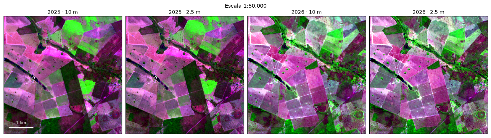
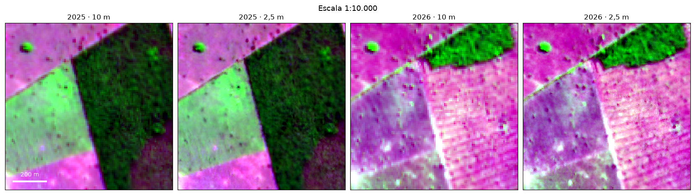

# Sentinel-2 Super-Resolution for Prodes Composition

<p align="center">
  
  
  
</p>

Super-resolução dos mosaicos Sentinel-2 de 16 dias do Brazil Data Cube (`S2-16D-2`) (FERREIRA et al., 2020), de 10 m para 2,5 m, com o modelo de difusão LDSR-S2 (DONIKE et al., 2025a), na implementação do pacote opensr-model (DONIKE et al., 2025b). O produto é um material de apoio à interpretação visual do Prodes na composição R = B11, G = B08, B = B04.

## Exemplos

Pantanal, tile 018023, mosaicos de 28/07/2025 e 28/07/2026, na composição Prodes (R = B11, G = B08, B = B04). Em cada ano, as imagens de 10 m e de 2,5 m usam o mesmo realce (percentis de 2 a 98% da imagem de 10 m). As escalas valem para as figuras em tamanho original, com cada painel de 400 pixels (10,16 cm).

<p align="center">
  
</p>

Na escala 1:50.000, as imagens de 10 m e de 2,5 m são praticamente iguais. Os talhões, os remanescentes de vegetação e o desmatamento entre 2025 e 2026 são identificados da mesma forma nas duas resoluções.

<p align="center">
  
</p>

Na escala 1:10.000, centrada no fragmento de vegetação desmatado entre os dois anos, a imagem de 2,5 m mostra detalhes que a de 10 m não resolve: os sulcos paralelos deixados pela passagem de trator na área aberta, a remoção das copas no interior do fragmento e as árvores isoladas que permaneceram. No Prodes Pantanal, que tem classes de manejo, esse nível de detalhe ajuda a identificar se houve remoção de copas ou passagem de máquinas.

## Uso no Prodes

No Prodes, o desmatamento é mapeado por interpretação visual: o intérprete compara imagens da mesma época em anos consecutivos e delimita apenas os incrementos fora da máscara de desmatamento acumulado (ALMEIDA et al., 2022). A interpretação continua sendo feita sobre as imagens oficiais do projeto. O produto de 2,5 m entra como camada auxiliar, consultada ao lado delas, para:

- conferir limites de polígonos em bordas irregulares ou pouco contrastadas;
- confirmar cortes pequenos, estradas e árvores remanescentes que, a 10 m, ficam no limite do que se distingue;
- verificar sinais de manejo, como remoção de copas e passagem de trator, em escalas próximas de 1:10.000;
- ajudar a separar corte raso de degradação quando a imagem original deixa dúvida.

Em escalas de mapeamento como 1:50.000, o ganho é pequeno, e as imagens atuais seguem suficientes.

Ele não deve ser usado como fonte única do mapeamento, pelos motivos abaixo:

- A super-resolução não acrescenta informação ao dado de 10 m. O modelo reconstrói o detalhe mais provável para cada textura, e esse detalhe pode não corresponder ao terreno. Em caso de divergência, vale a imagem original.
- A B11 (canal vermelho da composição) é uma banda de 20 m, e o detalhe dela a 2,5 m vem das bandas de 10 m (ver 3.4). A cor representa a resposta do SWIR, mas o contorno vem do visível e do infravermelho próximo.
- Nuvens e sombras residuais dos mosaicos de 16 dias passam para o produto de 2,5 m sem correção.

## 1. Instalação

Requer Python 3.10 ou superior e uma GPU NVIDIA com CUDA. Instale o [PyTorch](https://pytorch.org/get-started/locally/) para a sua versão de CUDA e depois:

```bash
pip install -r requirements.txt
```

Os pesos do modelo são baixados automaticamente na primeira execução. Dependências que faltarem também são instaladas pelo próprio script, no bloco 2.

## 2. Uso

O [`sen2sr-prodes.py`](sen2sr-prodes.py) é dividido em blocos `# %%`, que podem ser executados como células no Jupyter ou no VS Code, ou de uma vez com `python sen2sr-prodes.py`. Os parâmetros ficam no bloco 1.

| Parâmetro | Descrição |
| --- | --- |
| `TILES` | Tiles da grade BDC_SM_V2 (`hhhvvv`) |
| `DATES` | Data de início do mosaico de 16 dias. Os mosaicos do `S2-16D-2` começam a cada 16 dias a partir de 1º de janeiro: `2026-07-28` corresponde ao período de 28/07 a 12/08/2026 |
| `ROOT`, `OUT_DIR`, `DOWNLOAD_DIR` | Pasta de trabalho (modelos), resultados e mosaicos baixados |
| `ROI_LAT`, `ROI_LON`, `ROI_SIZE_KM` | `None` processa o tile inteiro; com um ponto, apenas um quadrado de `ROI_SIZE_KM` em torno dele |
| `MODE` | `fast` (padrão), `combined` ou `separate` (ver 3.5) |
| `STEPS` | Passos DDIM da difusão. 25 tem a mesma qualidade de 50 e é 1,6 vez mais rápido |
| `OVERWRITE` | `False` pula os pares tile e data que já têm resultado |

O bloco 2 processa todos os pares `TILES` × `DATES`, uma data por vez. Se a execução for interrompida, basta rodar o bloco 2 de novo: os pares prontos são pulados e o tile em andamento continua da última faixa gravada. Os blocos 3 e 4, opcionais, mostram a composição Prodes do último resultado e comparam os modos; as mesmas rotinas estão em [`tools/`](tools).

## 3. Metodologia

### 3.1 Dados de entrada

Para cada tile e data, o script baixa do STAC do Brazil Data Cube (`https://data.inpe.br/bdc/stac/v1`) os COGs do mosaico `S2-16D-2`: as bandas B02, B03, B04 e B08 (10 m), a B11 (20 m, já reamostrada para 10 m no cubo) e as camadas `PROVENANCE` e `CLEAROB`. As bandas são convertidas para reflectância (fator 0,0001), e o valor 0 fica reservado para nodata.

### 3.2 Janelas

O tile (10.560 × 10.560 pixels de 10 m) é processado em janelas de 128 × 128 pixels (1,28 km), com sobreposição de 16 pixels, o que dá cerca de 9.000 janelas por tile. Cada janela gera 512 × 512 pixels de 2,5 m. Nas sobreposições, as janelas vizinhas são combinadas com pesos que decaem suavemente em direção às bordas, descartando os 2 pixels mais externos, o que evita costuras entre janelas. Janelas com menos de 2% de dado válido são puladas.

### 3.3 LDSR-S2

O LDSR-S2 é um modelo de difusão latente para super-resolução de Sentinel-2 com fator 4, aplicado às bandas B04, B03, B02 e B08 (DONIKE et al., 2025a). O script usa o modelo e os pesos distribuídos no pacote opensr-model, versão 1.0.8 (DONIKE et al., 2025b). A difusão roda com 25 passos DDIM e semente fixa (42), de modo que a mesma configuração, na mesma máquina, gera o mesmo resultado.

Depois da difusão, o histograma de cada banda de cada janela é ajustado ao histograma da mesma banda a 10 m. Assim, o produto de 2,5 m mantém a radiometria do mosaico original e não há diferença de cor entre janelas. Dentro da área válida, a reflectância mínima é limitada a 0,0001, para que nenhum pixel válido se confunda com nodata.

### 3.4 Sharpening da B11 (modo `fast`)

A B11 do BDC é uma banda de 20 m reamostrada para 10 m e não tem detalhe abaixo de cerca de 20 m. No modo `fast`, ela é levada a 2,5 m por injeção de detalhe com regressão, técnica de pansharpening:

1. As bandas B04, B03, B02 e B08 de 10 m são suavizadas até a resolução efetiva da B11 (filtro gaussiano, sigma de 1 pixel), e em cada janela ajusta-se uma regressão ridge da B11 sobre essas bandas suavizadas.
2. A B11 de 2,5 m é a B11 interpolada (bicúbica) somada ao detalhe das bandas de 2,5 m do LDSR-S2, ponderado pelos coeficientes da regressão. O detalhe é a diferença entre cada banda de 2,5 m e sua versão suavizada.
3. O resultado é corrigido para que, degradado de volta a 10 m e à resolução da B11, reproduza a B11 original.

Num teste pelo protocolo de Wald (WALD; RANCHIN; MANGOLINI, 1997), com degradação de 4 vezes sobre dados do BDC, essa versão reduziu o RMSE da B11 em 29% e elevou a correlação do detalhe de 0,37 para 0,53 em relação à versão anterior.

### 3.5 Modos

| Modo | Bandas de 10 m | B11 | Tempo por janela |
| --- | --- | --- | --- |
| `fast` | LDSR-S2 | sharpening com as bandas do LDSR-S2 (3.4) | ~1 s |
| `combined` | LDSR-S2 (modelo LDSRS2-SEN2SR, 10 bandas) | SEN2SR | ~3 s |
| `separate` | LDSR-S2 | SEN2SR em separado | |

Nos modos `fast` e `combined`, as bandas B04 e B08 vêm da mesma difusão do LDSR-S2, de modo que os dois diferem apenas na B11. O SEN2SR (ESA OPENSR, 2025) só é usado nos modos `combined` e `separate`. O Pantanal e o Lavrado foram processados no modo `fast`.

### 3.6 Execução

A precisão numérica (fp32/TF32 ou bf16) e o tamanho do lote são escolhidos automaticamente para a GPU disponível. Cada tile grava pontos de controle a cada poucas faixas, o que permite retomar uma execução interrompida. O log de cada execução e um relatório em JSON (hardware, parâmetros, tempos e arquivos) ficam em `OUT_DIR/logs`.

Numa H100 MIG 3g.47gb, cada tile leva cerca de 47 min de super-resolução (9.025 janelas, 3,2 janelas por segundo), mais o tempo de download do mosaico.

## 4. Produto

| Item | Valor |
| --- | --- |
| Arquivo | `OUT_DIR/<tile>_<data>_fast_tile.tif` (ex.: `018023_20260728_fast_tile.tif`) |
| Bandas | 1 B04, 2 B03, 3 B02, 4 B08, 5 B11 |
| Valores | Reflectância × 10000, int16; nodata = 0 |
| Grade | 2,5 m, Albers da grade BDC (mesma projeção do cubo), 42.240 × 42.240 pixels por tile |
| Tamanho | Cerca de 9 GB por tile (GeoTIFF com compressão ZSTD) |
| Metadados | Modelo, modo, passos, precisão, GPU e mosaico de origem, nas tags do GeoTIFF |

Para a composição Prodes no QGIS, use renderização multibanda com R = banda 5 (B11), G = banda 4 (B08) e B = banda 1 (B04); para cor natural, bandas 1, 2 e 3. Como os arquivos são grandes, gere pirâmides antes de abrir:

```bash
gdaladdo -ro -r average --config COMPRESS_OVERVIEW ZSTD --config PREDICTOR_OVERVIEW 2 \
  --config BIGTIFF_OVERVIEW YES 018023_20260728_fast_tile.tif 2 4 8 16 32 64
```

## 5. Ferramentas

- [`tools/preview_prodes.py`](tools/preview_prodes.py): composição Prodes do último resultado, com a visão geral e um recorte de 10 m ao lado do mesmo recorte de 2,5 m. Uso: `python tools/preview_prodes.py OUT_DIR`.
- [`tools/compare_modes.py`](tools/compare_modes.py): compara a imagem original com os produtos de cada modo, em cor natural, na composição Prodes e na B11 isolada, com métricas de viés, erro e detalhe. Uso: `python tools/compare_modes.py TILE DATA OUT_DIR`.

## Referências

ALMEIDA, C. A.; MAURANO, L. E. P.; VALERIANO, D. M.; CÂMARA, G.; VINHAS, L.; MOTTA, M.; GOMES, A. R.; MONTEIRO, A. M. V.; SOUZA, A. A. A.; MESSIAS, C. G.; RENNÓ, C. D.; ADAMI, M.; ESCADA, M. I. S.; SOLER, L. S.; AMARAL, S. **Metodologia utilizada nos sistemas PRODES e DETER – 2ª edição (atualizada)**. 2. ed. São José dos Campos: INPE, 2022. 47 p. Disponível em: http://urlib.net/ibi/8JMKD3MGP3W34T/47GAF6S.

DONIKE, S.; AYBAR, C.; GÓMEZ-CHOVA, L.; KALAITZIS, F. Trustworthy super-resolution of multispectral Sentinel-2 imagery with latent diffusion. **IEEE Journal of Selected Topics in Applied Earth Observations and Remote Sensing**, v. 18, p. 6940-6952, 2025a. DOI: 10.1109/JSTARS.2025.3542220.

DONIKE, S.; AYBAR, C.; GÓMEZ-CHOVA, L.; KALAITZIS, F. **opensr-model**: ESA OpenSR diffusion model package for super-resolution of Sentinel-2 imagery. Versão 1.0.8. 2025b. Disponível em: https://github.com/ESAOpenSR/opensr-model.

ESA OPENSR. **SEN2SR**: super-resolution of Sentinel-2 imagery to 2.5 m. 2025. Disponível em: https://github.com/ESAOpenSR/sen2sr.

FERREIRA, K. R. et al. Earth observation data cubes for Brazil: requirements, methodology and products. **Remote Sensing**, v. 12, n. 24, 4033, 2020. DOI: 10.3390/rs12244033.

WALD, L.; RANCHIN, T.; MANGOLINI, M. Fusion of satellite images of different spatial resolutions: assessing the quality of resulting images. **Photogrammetric Engineering and Remote Sensing**, v. 63, n. 6, p. 691-699, 1997.

## Licença

Distribuído sob a licença [GNU GPL v3.0](LICENSE).
